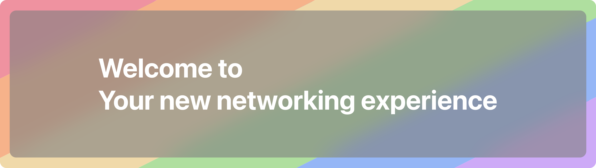

# NetGoat frontend — v2

The Next.js control panel for NetGoat. This branch (`frontend-v2`) is a ground-up
rewrite of the dashboard: a team-scoped workspace for domains, subdomains, WAF
rules, routes, TLS, access lists and analytics, backed by MongoDB and Better Auth.

> **Status:** active development. This branch is not merged into `main` and is
> not deployed to production. The `main` branch still serves the current
> dashboard.

## What it does

A signed-in user belongs to one or more teams. Each team owns domains; each
domain has zone-wide edge policy and nested subdomains with their own policy.
This app is the UI and the session/data layer for that model.

| Area | Routes |
| --- | --- |
| Marketing site | `/` |
| Auth | `/auth/login`, `/auth/register`, `/auth/forgot-password`, `/auth/verify-email`, magic-link and OTP variants |
| Workspace | `/dashboard`, `/dashboard/teams`, `/dashboard/[teamName]` |
| Domain management | `/dashboard/[teamName]/[domainName]/{dns,ssl,waf,access,reverse-proxies,analytics,logs,settings}` |
| Subdomains | `/dashboard/[teamName]/[domainName]/subdomains/[subdomain]/{waf,ssl,access,reverse-proxies}` |
| Account | `/account/{activity,billing,security}` |
| Admin | `/admin/{users,system,settings,logs,incidents,alerts,analytics,content,feedback}` |
| API | `/api/auth/[...all]`, `/api/analytics`, `/api/admin/logs`, `/api/cron/verify-domains`, `/api/upload` |

## Stack

| Layer | Choice |
| --- | --- |
| Framework | Next.js 16 (App Router, React 19, Turbopack) |
| Language | TypeScript 5.9 |
| Styling | Tailwind CSS 4, Coss UI primitives, `motion` |
| Icons | Hugeicons |
| Auth | Better Auth (email/password, magic link, OTP, GitHub/GitLab/Discord) |
| Database | MongoDB via Mongoose |
| Email | Resend |
| Billing | Polar (optional) |
| Validation | Zod |
| Package manager | Bun |

## Prerequisites

- Bun 1.2 or newer
- Node.js 22 or newer (runtime for the production image)
- A MongoDB instance (local or Atlas)

## Local development

```bash
cp .env.example .env      # fill in the required values
bun install
bun run dev               # http://localhost:3002
```

`MONGODB_URI`, `BETTER_AUTH_SECRET` and `RESEND_APIKEY` are required; the app
validates them lazily and fails loudly on the first server access if they are
missing (see `lib/env.ts`).

## Scripts

| Command | Purpose |
| --- | --- |
| `bun run dev` | Development server on port 3002 |
| `bun run build` | Production build (standalone output) |
| `bun run start` | Serve the production build |
| `bun run lint` | ESLint (Next.js core-web-vitals + TypeScript rules) |
| `bun run typecheck` | `tsc --noEmit` |

## Configuration

All variables are documented in [`.env.example`](.env.example). Required:

| Variable | Notes |
| --- | --- |
| `MONGODB_URI` | MongoDB connection string |
| `BETTER_AUTH_SECRET` | At least 16 characters; `openssl rand -base64 32` |
| `RESEND_APIKEY` | Resend API key for transactional email |

Optional: `BETTER_AUTH_URL`, `NEXT_PUBLIC_SITE_URL`, `EMAIL_FROM`,
`EXTERNAL_API_URL`, `CRON_SECRET`, OAuth client pairs for GitHub/GitLab/Discord,
and the Polar billing identifiers.

Never commit `.env`. Only `.env.example` with placeholder values belongs in Git.

## Docker

```bash
docker build -t netgoat-frontend .
docker run --rm -p 3002:3002 --env-file .env netgoat-frontend
```

The image uses Next.js standalone output on a distroless Node 22 base, runs as
a non-root user, and exposes port 3002. Published images live at
`ghcr.io/netgoat-xyz/frontend`.

## Deployment

The app needs a MongoDB instance, outbound HTTPS for Resend and OAuth providers,
and a writable upload path if `/api/upload` is enabled. Terminate TLS at a
reverse proxy and set `BETTER_AUTH_URL` / `NEXT_PUBLIC_SITE_URL` to the public
origin. `CRON_SECRET` authorises `/api/cron/verify-domains`, which should be
called by a scheduler with `Authorization: Bearer $CRON_SECRET`.

## Security

- Secrets are read from the environment only; nothing is hardcoded.
- Session handling and password hashing are delegated to Better Auth.
- Route handlers validate input with Zod before touching MongoDB.
- Report vulnerabilities per [SECURITY.md](SECURITY.md); do not open a public issue.

## Contributing

See [CONTRIBUTING.md](CONTRIBUTING.md). Work on a branch, keep pull requests
focused, and make sure `lint`, `typecheck` and the build pass before requesting
review. CI runs the same checks on every pull request.

## License

See [LICENSE](LICENSE) in the repository root. NetGoat branding and mascot
artwork are project assets and are not licensed for reuse as third-party
branding.
